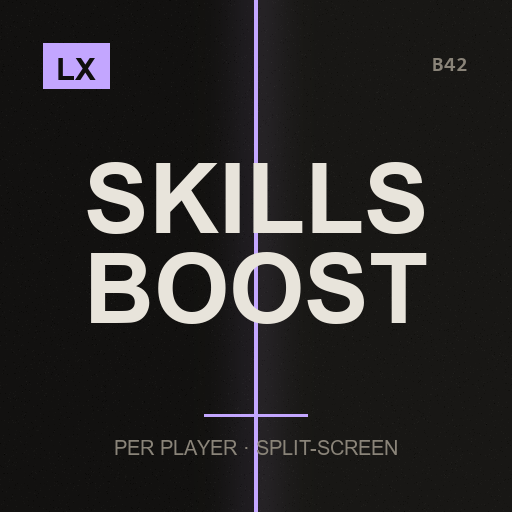

# LX Split-Screen Skills Boost

**A skill floor for every local character**

> Two people on one couch should be building and fighting, not grinding the same early levels twice.

`Project Zomboid B42.21+` · `v2.1.0` · `CC0`

[English](#english) · [Español](#español)

---

## English

This mod is part of the **LX Split-Screen Suite**, seven mods that make Project Zomboid B42 playable in 2–4 player couch co-op, with or without a gamepad. Each one stands alone — install only what you need.

### Why split-screen?

Split-screen is the mode that carries the most bugs in stable B42 — and the mods worth playing with, like Bandits and Project A-Life, are built for singleplayer and online multiplayer. Nobody is fixing couch co-op. This suite exists to close that gap: to make split-screen as playable as the modes that get the attention.

### Why gamepad?

B42 keeps improving controller support, but it is still rough, and the aim-and-shoot rework left gunplay on a gamepad close to unusable — you cannot even shoot a zombie lying on the ground. Split-screen *with* a gamepad is the worst case the game offers. These mods give PZ back an aim that was designed for a stick: assist on the vertical axis, B41-style lock-on, per-player aim state, and a lot more.

### What it does

- **A floor, not a handout** — Levels are only ever **raised**. A character who is already above the floor keeps everything they have — the mod never takes a level away.
- **Two groups, both adjustable** — Combat (Strength, Fitness, Aiming, Reloading) defaults to 10. Crafting (Carpentry, Metalworking, Electrical, Mechanics, Masonry, Blacksmith, Carving, Tailoring, Pottery, Glassmaking, Butchering) defaults to 5, which is where most building recipes unlock. Set either to 0 to leave that group alone.
- **Every local character** — Players 1 through 4, each once, each tracked separately.
- **Recipes come with the levels** — It raises skills through the same path the game's own debug menu uses, which fires the level-up event — so the recipes those levels auto-unlock are actually learned, instead of you having the level but not the recipe.
- **Top up later** — Raise the floor in the options and existing characters catch up the next time they spawn. Lower it and nothing is taken away.

### Requirements

None. Vanilla B42.21 is enough.

### Installing

**From the Steam Workshop (recommended)**
Subscribe on the Workshop page. Steam downloads it; then start Project Zomboid, go to
**Mods** in the main menu and enable it. In split-screen, enabling it once covers all players.

**Manually**
1. Download this repository (green **Code** button -> **Download ZIP**) and unzip it.
2. Copy the folder `LX_SPLITSCREEN_SKILLS_IMPROVE` into your Zomboid mods folder:
   - Windows: `C:\Users\<you>\Zomboid\mods\`
   - Linux: `~/Zomboid/mods/`
   - macOS: `~/Library/Application Support/Zomboid/mods/`
   The result must be `...\Zomboid\mods\LX_SPLITSCREEN_SKILLS_IMPROVE\42\mod.info`.
3. Start the game, open **Mods** in the main menu and enable **LX Split-Screen Skills Boost**.

### Options

Options → MODS → **LX Split-Screen Skills Boost**. Master switch, combat floor (0–10) and crafting floor (0–10).

### Notes

- This is a convenience mod — it is meant to skip a grind you have already done, not to be balanced.
- Applied about 2.5 seconds after spawning, once the character has finished initialising.
- Works in normal singleplayer too; split-screen is just where doing the grind twice hurts most.

### License

**CC0 1.0 Universal** — public domain dedication. Do whatever you want with it: copy it, change it, put it in a modpack, publish it, sell it. No permission needed, no credit required (though it is always welcome). See `LICENSE`.

### The rest of the suite

- [LX Coop Fixes](https://github.com/litoxperaloca/LX_CoopFixes) — Split-screen stability: vehicle crash, player 2 aiming, map stutter, error spam.
- [LX Split Aim](https://github.com/litoxperaloca/LX_SplitAim) — Controller aim assist and B41-style lock-on, per local player.
- [LX Split-Screen Quick Build](https://github.com/litoxperaloca/LX_SPLITSCREEN_CONTEXTMENU_BUILDING) — B41-style build menu in the context menu, because B42's window does not fit.
- [LX A-Life Split-Screen Fix](https://github.com/litoxperaloca/LX_ALifeSplit) — Project A-Life NPCs react to every local player, not just player 1.
- [LX Bandits Split-Screen Fix](https://github.com/litoxperaloca/LX_BanditsSplit) — Bandits target the right player, companions follow who recruited them.
- [LX Split-Screen Welcome Package](https://github.com/litoxperaloca/LX_SPLITSCREEN_WELCOME_PACKAGE) — A configurable starter kit per local character.

---

## Español

> Dos personas en un sillón deberían estar construyendo y peleando, no moliendo los mismos niveles iniciales dos veces.

Este mod es parte de la **LX Split-Screen Suite**, siete mods que hacen jugable Project Zomboid B42 en coop de sillón de 2 a 4 jugadores, con o sin mando. Cada uno funciona por separado — instalá solo lo que precises.

### ¿Por qué pantalla dividida?

Es la modalidad con más bugs en la B42 estable — y los mods que valen la pena, como Bandits y Project A-Life, están pensados para un jugador y multijugador online. Nadie arregla el coop de sillón. Esta suite existe para cerrar esa brecha: dejar la pantalla dividida a la par de las modalidades que sí reciben atención.

### ¿Por qué mando?

La B42 viene mejorando el soporte de mando, pero todavía deja mucho que desear, y el rework de apuntado y disparo dejó el tiroteo con mando casi imposible — ni siquiera podés dispararle a un zombi en el suelo. Pantalla dividida *con* mando es el peor escenario posible del juego. Estos mods le devuelven a PZ un apuntado pensado para stick: asistencia en el eje vertical, fijado de blanco estilo B41, estado de apuntado por jugador, y bastante más.

### Qué hace

- **Un piso, no un regalo** — Los niveles solo **suben**. Un personaje que ya está por encima del piso conserva todo lo que tiene — el mod nunca saca un nivel.
- **Dos grupos, los dos ajustables** — Combate (Fuerza, Estado físico, Puntería, Recarga) viene en 10. Crafteo (Carpintería, Metalistería, Electricidad, Mecánica, Albañilería, Herrería, Tallado, Costura, Alfarería, Vidriería, Carnicería) viene en 5, que es donde se desbloquean casi todas las recetas de construcción. Poné cualquiera en 0 para no tocar ese grupo.
- **Cada personaje local** — Jugadores 1 a 4, cada uno una vez, cada uno registrado por separado.
- **Las recetas vienen con los niveles** — Sube las habilidades por el mismo camino que usa el menú de debug del juego, que dispara el evento de subida de nivel — así las recetas que esos niveles desbloquean solas se aprenden de verdad, en vez de quedarte con el nivel pero sin la receta.
- **Completar después** — Subí el piso en las opciones y los personajes existentes se ponen al día la próxima vez que aparezcan. Bajálo y no se saca nada.

### Requisitos

Ninguno. Alcanza con B42.21 vanilla.

### Instalación

**Desde el Steam Workshop (recomendado)**
Suscribite en la página del Workshop. Steam lo descarga solo; después abrí Project Zomboid,
andá a **Mods** en el menú principal y activalo. En pantalla dividida, con activarlo una vez
alcanza para todos los jugadores.

**A mano**
1. Descargá este repositorio (botón verde **Code** -> **Download ZIP**) y descomprimilo.
2. Copiá la carpeta `LX_SPLITSCREEN_SKILLS_IMPROVE` a tu carpeta de mods de Zomboid:
   - Windows: `C:\Users\<vos>\Zomboid\mods\`
   - Linux: `~/Zomboid/mods/`
   - macOS: `~/Library/Application Support/Zomboid/mods/`
   Tiene que quedar `...\Zomboid\mods\LX_SPLITSCREEN_SKILLS_IMPROVE\42\mod.info`.
3. Abrí el juego, entrá a **Mods** en el menú principal y activá **LX Split-Screen Skills Boost**.

### Opciones

Opciones → MODS → **LX Pantalla dividida: mejora de habilidades**. Interruptor general, piso de combate (0–10) y piso de crafteo (0–10).

### Notas

- Es un mod de comodidad — está para saltearse un grindeo que ya hiciste, no para estar balanceado.
- Se aplica unos 2,5 segundos después de aparecer, cuando el personaje terminó de inicializarse.
- Funciona también en un jugador normal; la pantalla dividida es solo donde más duele hacer el grindeo dos veces.

### Licencia

**CC0 1.0 Universal** — dedicado al dominio público. Hacé lo que quieras: copialo, cambialo, metélo en un modpack, publicalo, vendelo. No hace falta permiso ni crédito (aunque siempre se agradece). Ver `LICENSE`.

### El resto de la suite

- [LX Coop Fixes](https://github.com/litoxperaloca/LX_CoopFixes) — Estabilidad en pantalla dividida: crash de vehículos, apuntado del jugador 2, tirones del mapa, spam de errores.
- [LX Split Aim](https://github.com/litoxperaloca/LX_SplitAim) — Asistencia de apuntado con mando y fijado de blanco estilo B41, por jugador local.
- [LX Split-Screen Quick Build](https://github.com/litoxperaloca/LX_SPLITSCREEN_CONTEXTMENU_BUILDING) — Menú de construcción estilo B41 en el menú contextual, porque la ventana de B42 no entra.
- [LX A-Life Split-Screen Fix](https://github.com/litoxperaloca/LX_ALifeSplit) — Los NPCs de Project A-Life reaccionan a todos los jugadores locales, no solo al 1.
- [LX Bandits Split-Screen Fix](https://github.com/litoxperaloca/LX_BanditsSplit) — Los bandidos apuntan al jugador correcto, los compañeros siguen a quien los reclutó.
- [LX Split-Screen Welcome Package](https://github.com/litoxperaloca/LX_SPLITSCREEN_WELCOME_PACKAGE) — Un equipo inicial configurable por personaje local.

